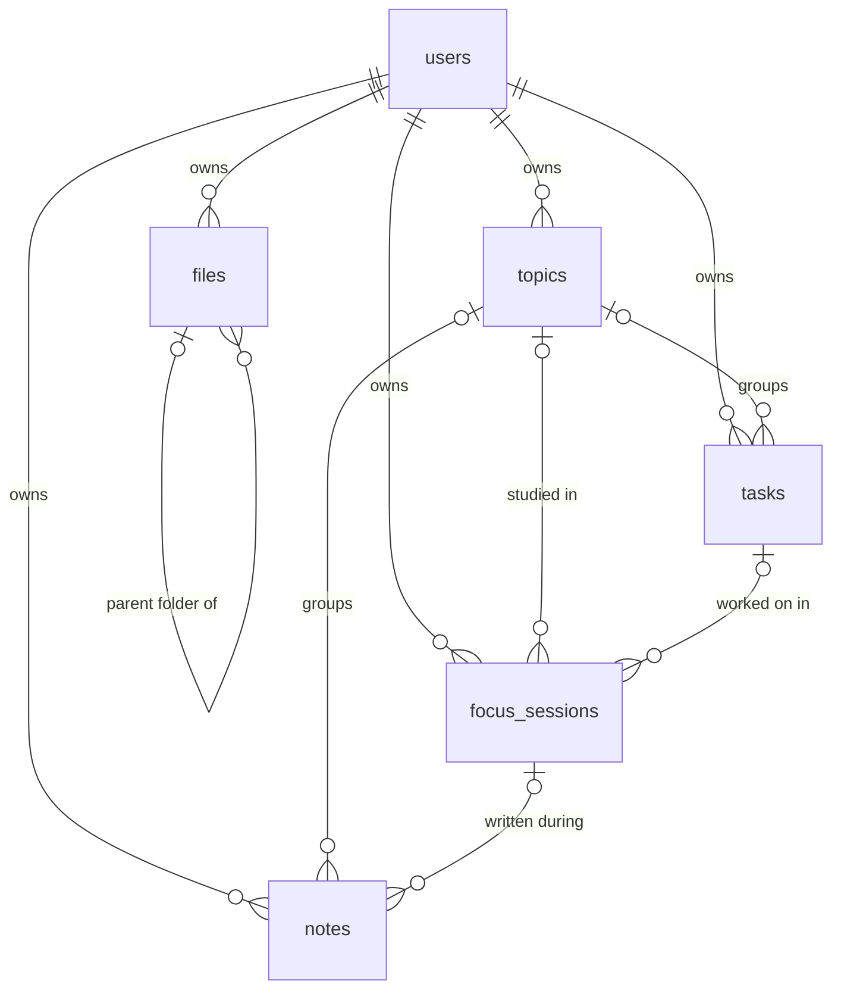

# 001 — Designing the database first

**Date:** 2026-09-25
**Files:** `src/db/schema.ts`, `drizzle/0000_init.sql`, `drizzle.config.ts`, `src/db/index.ts`

## The problem

The UI was fully built with fake data (the "72%", the "42h", the hardcoded tasks). Before wiring
anything up, we need to decide **what the app actually remembers**. The data model shapes
every screen, so it comes first.

## The core idea: everything hangs off a Session

FocusOrbit is "a place where you code and write notes while a timer tracks your focus, and
you can look back at what you studied." Break that sentence into nouns:

| Noun in the idea | Table |
|---|---|
| you | `users` |
| what you studied | `topics` |
| what you planned to do | `tasks` |
| a timed block of focus | `focus_sessions` ← **the center** |
| what you wrote | `notes` |
| the code you wrote | `files` |

"History" and "motivation" are **not** tables. History = past sessions. Motivation
(streaks, hours this week, % of daily goal) = numbers **computed from** sessions.



## Decisions and why

### 1. PostgreSQL + Drizzle ORM
- **Options:** Postgres, SQLite, MongoDB · Prisma, Drizzle, raw SQL.
- **Chose:** Postgres, because the data is relational (sessions → topics → notes) and we want real
  constraints. Drizzle, because the schema is plain TypeScript that looks like SQL, there's no
  code-generation step, and the migrations it produces are readable `.sql` files. You learn
  SQL instead of hiding from it.

### 2. Clerk owns identity; `users.id` = the Clerk user id
- We **don't** copy email/name/avatar. Clerk already has them, and duplicates go stale.
- We only store what *our* features need: `timezone` (for "today" and streaks) and
  `daily_goal_minutes`.

### 3. Don't store what you can derive
- No `streak`, `total_hours` or `progress_percentage` columns. Those are queries over
  `focus_sessions`.
- **Why:** a stored number can disagree with the data it came from. A computed one can't.
  If it ever gets slow, add a cache later. Correctness first.

### 4. Pause/resume without a `pauses` table
```
resume → last_resumed_at = now
pause  → focused_seconds += now - last_resumed_at ; last_resumed_at = null
live focused time = focused_seconds + (now - last_resumed_at)
```
Two columns fully describe a pausable timer. It also fixes the frontend drift bug: the
truth is timestamps, not a counter decremented by `setInterval`.

### 5. Let the database enforce the rules
| Rule | How |
|---|---|
| Only one active session per user | **partial unique index** on `user_id` `WHERE status IN ('running','paused')` |
| Planned time must be positive | `CHECK (planned_seconds > 0)` |
| Folders have no content | `CHECK (kind = 'file' OR content IS NULL)` |
| No duplicate names in a folder, **including the root** | `UNIQUE NULLS NOT DISTINCT (user_id, parent_id, name)` |
| No duplicate topic names per user | `UNIQUE (user_id, name)` |

**Why in the DB and not just the UI:** two browser tabs, a double click, or a bug in some
future code path can all bypass UI checks. The database is the last line of defense.

> 💡 `NULLS NOT DISTINCT`: normally in SQL `NULL ≠ NULL`, so root-level files (parent_id is null)
> would never collide. This Postgres 15+ option treats them as equal.

### 6. `ON DELETE`: cascade vs. set null
- **Cascade** when the child can't exist without the parent: delete a user → all their data goes;
  delete a folder → its contents go.
- **Set null** when the child still has value on its own: delete a topic → your notes and
  session history stay, just unlabeled.

### 7. The file tree is an "adjacency list"
Each row points at its parent (`parent_id → files.id`). It's the simplest tree model: moving
a file is one `UPDATE`. Reading a whole tree needs a recursive query (`WITH RECURSIVE`),
which we'll learn when we build the explorer.

### 8. Other conventions
- `uuid` ids: safe to show in URLs, and they can be generated anywhere.
- `timestamptz` everywhere: store instants in UTC and convert to the user's timezone only for display.
- Soft delete (`archived_at`) for notes and topics, so the user can restore them.
- Notes are **Markdown text** for now. A block editor (like the Notes mockup) may want JSON later,
  and that would be a migration.

## What we deliberately left out (YAGNI)
- Break sessions (short/long Pomodoro breaks). They can be added as a `kind` column.
- Linking which files were touched in a session.
- Tags (many-to-many). A single topic is enough to start with.

## Things to try
1. Open `drizzle/0000_init.sql` and match each line back to `schema.ts`.
2. After `npm run db:seed`, try inserting a second `running` session for `user_demo` in Studio and
   watch the partial unique index reject it.
